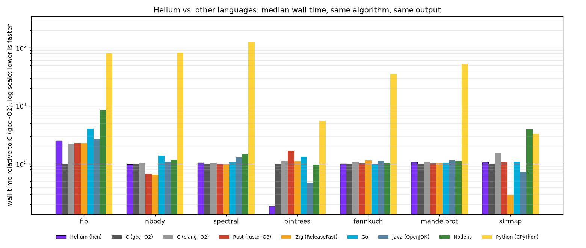
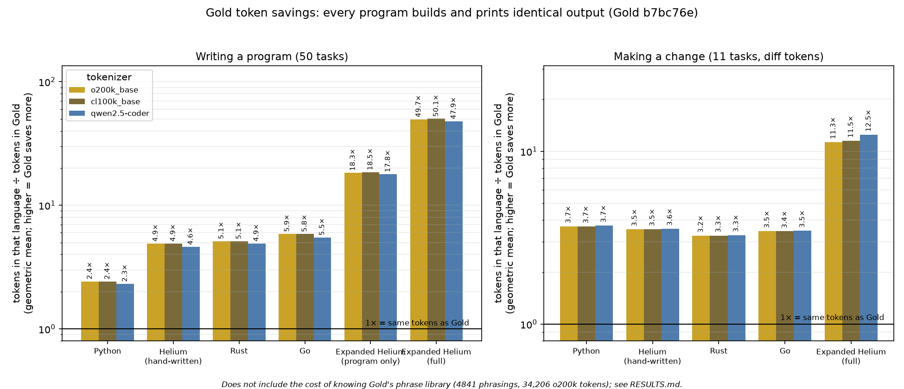

# Helium

**A memory-safe systems language with no heap, no garbage collector and no lifetime annotations, designed for code that language models read and write.**

Helium is designed and implemented by Anthony Reffelt ([Amniscient](https://github.com/Amnibro)). Its compiler, `hc`, is written in Helium and builds itself. It writes x86-64 executables directly (its own code generator, optimizer and ELF writer, no C compiler, assembler or linker), WebAssembly for the browser and node, or C.

## Build

```bash
hc/bootstrap.sh
build/hcn run samples/01_tour.amni
```

`hc/bootstrap.sh` compiles the checked-in seed (`hc/seed/hc.c`) once with `cc` (clang by default, `CC=gcc` works too), rebuilds hc with itself until the output stops changing, and checks that the native build reproduces itself. `build/hcn` is the native self-built compiler; `build/hc` is the same compiler built through C.

## Use

| Command | What it does |
|---|---|
| `hc run file [-- args]` | compile natively into `~/.cache/hc` and run (`hc file` does the same) |
| `hc build file [-o out]` | build an executable; `-o out.c` writes C, `--web` writes `out.wasm` |
| `hc check file` | parse and typecheck only |
| `hc fetch [--update] file` | clone the git packages the program declares (`import name from "owner/repo@ref";`) |
| `hc lsp` | language server: diagnostics, hover, definition, references, rename, symbols, completion, signature help, inlay hints |

Options: `--debug` (overflow, range and tag checks naming the source line), `-DNAME=V` (runtime defines), `--offline` (fetch nothing). The library directory is `HC_LIB`, else `lib` beside the executable.

## The language

Two syntaxes with the same semantics: `.amni` (braces and `;`) and `.he` (indentation, no `;`, `x := e`, `fn` optional), which hc and its library are written in. [HELIUM.md](HELIUM.md) teaches the whole language in about 3.9k tokens; `hc/TODO.md` §0 lists what `.he` changes.

The library in `hc/lib` is Helium throughout: `std`, `os`, `math`, `json`, `regex`, `dictionary`, `csv`, `base64`, `binary`, `ffi`; `gfx` straight on SDL3's GPU API with a GLSL to SPIR-V/MSL/HLSL shader compiler inside hc; `ui` (a port of Nuklear); `physics` (a port of Box3D); `audio`; `web` and `webgl` for the browser.

## Performance

Seven programs (Benchmarks Game n-body, spectral-norm, binary-trees, fannkuch-redux, plus
recursive fib, a Mandelbrot count and a string-keyed hash map), each written with the same
algorithm in Helium, C, Rust, Zig, Go, Java, JavaScript and Python and checked for identical
output. Median wall time of 5 runs on an AMD Ryzen 9 9950X3D, single-threaded.

Geometric mean of wall time, Helium against each language:

| Helium (hcn) against | all 7 programs | without bintrees |
|---|---:|---:|
| Rust (rustc -O3) | Helium 1.25× faster | Helium 1.11× slower |
| Go | Helium 1.48× faster | Helium 1.14× faster |
| Java (OpenJDK) | Helium 1.16× faster | Helium 1.02× faster |
| Node.js | Helium 1.95× faster | Helium 1.67× faster |
| Python (CPython) | Helium 33.45× faster | Helium 34.26× faster |
| Zig (ReleaseFast) | Helium 1.01× slower | Helium 1.36× slower |
| C (clang -O2) | Helium 1.35× faster | Helium 1.06× faster |
| C (gcc -O2) | Helium 1.08× faster | Helium 1.21× slower |



The chart shows speedup over C (gcc -O2), log scale, higher is faster; the right panel is the
geometric mean with and without binary-trees. Per-program wall times:

| Program | Helium (hcn) | C (gcc -O2) | C (clang -O2) | Rust (rustc -O3) | Zig (ReleaseFast) | Go | Java (OpenJDK) | Node.js | Python (CPython) |
|---|---:|---:|---:|---:|---:|---:|---:|---:|---:|
| fib | 190 ms | 75 ms | 169 ms | 170 ms | 170 ms | 305 ms | 200 ms | 634 ms | 6017 ms |
| nbody | 368 ms | 371 ms | 386 ms | 250 ms | 243 ms | 516 ms | 409 ms | 440 ms | 30.5 s |
| spectral | 287 ms | 273 ms | 286 ms | 274 ms | 268 ms | 290 ms | 353 ms | 404 ms | 34.4 s |
| bintrees | 129 ms | 683 ms | 759 ms | 1148 ms | 759 ms | 912 ms | 326 ms | 661 ms | 3740 ms |
| fannkuch | 1816 ms | 1800 ms | 1956 ms | 1822 ms | 2058 ms | 1790 ms | 2044 ms | 1857 ms | 64.0 s |
| mandelbrot | 656 ms | 602 ms | 656 ms | 614 ms | 625 ms | 630 ms | 691 ms | 676 ms | 31.6 s |
| strmap | 793 ms | 731 ms | 1114 ms | 779 ms | 215 ms | 801 ms | 535 ms | 2869 ms | 2406 ms |
| geomean time vs C (gcc) | 0.93× | 1.00× | 1.26× | 1.16× | 0.92× | 1.37× | 1.08× | 1.82× | 31.09× |
| geomean without bintrees | 1.21× | 1.00× | 1.28× | 1.09× | 0.89× | 1.38× | 1.24× | 2.02× | 41.53× |

Helium is ahead on binary-trees because its program builds each tree in a pool instead of
allocating every node; against a C program that does the same it is 1.6× slower (129 ms vs.
81 ms). Without binary-trees its geometric mean is 1.21× C's. It loses on fib (2.5× gcc, which
inlines the recursion into itself, and 1.1× clang, Rust and Zig), on nbody (Rust and Zig are
1.5× faster) and on strmap (Zig's `StringHashMap` is 3.7× faster, Java's `HashMap` 1.5×). Executables are larger than C's or Zig's and smaller than Rust's or Go's.

Peak memory, executable size, compile time, machine details, the exact commands and the
differences between the implementations (notably binary-trees, where Helium's per-tree pool
is compared both with per-node allocation and with a C arena) are in
[bench/heavyweights/RESULTS.md](bench/heavyweights/RESULTS.md).

## Gold

Gold is a conversational layer over Helium. Each plain sentence (verb noun
modifier context, for example `run function x until y`) maps to a verified
Helium template, and a chain of sentences expands into one real Helium program
that `hc` checks, compiles and runs. Programming content can then be kept as
short scripts over a library of tested templates instead of hand-maintained
code. See [docs/gold.md](docs/gold.md).

Token benchmark ([bench/gold_tokens](bench/gold_tokens/RESULTS.md)): on 50 small
tasks where Gold and hand-written Helium, Rust, Go and Python all build and print
identical output, the same program takes 2.4× the tokens in Python, 4.9× in
Helium, 5.1× in Rust and 5.9× in Go (o200k_base, geometric mean of per-task
ratios). The Gold script, not the generated Helium, is what gets counted: the
expanded program is 18× the size of the script. The counts also leave out the
phrase library a writer has to know (about 34k tokens), and every task is one
Gold's library can express.



## Tests

```bash
tools/hc/ci.sh
```

Bootstraps if needed, then runs the corpus in `test/` and `samples/` natively, through C and as WebAssembly (each against the pass lists in `tools/hc/baseline/`), hc's own tests in `hc/test`, the vectorizer fuzzer, the language server fixtures, the web host and git package fetching. Every one of the 645 corpus programs passes natively. CI runs on your machine; nothing uses hosted runners.

## License

Apache License 2.0. See [LICENSE](LICENSE) and [NOTICE](NOTICE).

## Authorship and lineage

Helium, its two syntaxes, the compiler `hc` (front end, type and lifetime checker, optimizer,
x86-64 code generator and ELF writer, WebAssembly and C back ends, language server, package
fetcher), the runtime and the libraries in `hc/lib` are written by Anthony Reffelt
(Amniscient). hc was written from scratch in Helium; it replaced, rather than adapted, the
Goose C++ compiler, which was removed from this repository on 2026-10-27 (commit `450f08e5`).

Helium's memory model and core semantics started from
[Goose](https://github.com/aardappel/goose), a language by Wouter van Oortmerssen,
released under the Apache License 2.0. This repository's history begins with Goose's,
and some material is still Goose's work, used under that licence:

- `docs/`: the tutorial, reference, specification and design notes describe Goose and use
  its syntax (`.goose` files, the `goose` command); [HELIUM.md](HELIUM.md) is the Helium
  description.
- `test/` and `samples/`: most programs come from Goose's corpus, converted to `.amni`.
- `vscode/` and `tree-sitter/`: Goose's editor support.
- `bench/` outside `bench/heavyweights/`: Goose's benchmark programs and its results
  against C++ and Rust (see [bench/README.md](bench/README.md)).

`ui` is a port of [Nuklear](https://github.com/Immediate-Mode-UI/Nuklear) and `physics` a
port of [Box3D](https://github.com/erincatto/box3d); see [NOTICE](NOTICE).
